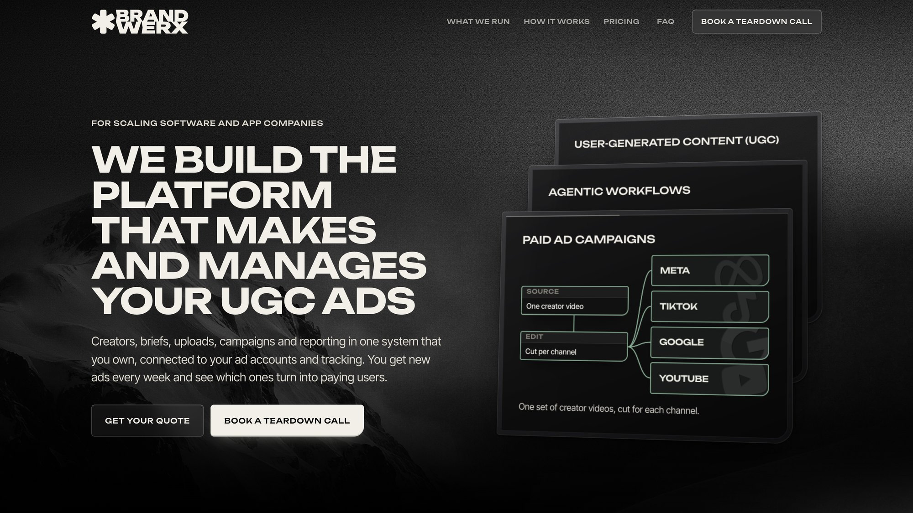

# BRANDWERX

This is a demo agency I built in about two days for Brez Scales and Commas's "Build Your Agency With AI" challenge. BRANDWERX makes UGC ads and builds the systems behind them for software and app companies. The website, CRM, email sequences and checkout all run on Commas.

The site is one page. It draws itself as a blueprint when it loads, walks through what gets built, and ends in a quote builder that picks a plan and sends you to its Commas checkout.

- **Live:** https://commas.com/fnl/org_RKI26HqqTzIj/brandwerx
- **Walkthrough video:** [video/walkthrough-1440p.mp4](video/walkthrough-1440p.mp4)

It is a demo. The leads in the CRM are fictional and the Monday Report numbers are samples.

[](https://commas.com/fnl/org_RKI26HqqTzIj/brandwerx)

The page has:
- **Hero:** who it's for, what you get, and Book a Teardown Call, with three cards that rotate through UGC, agentic workflows and paid ad campaigns.
- **What We Build:** the six pieces of the system, from the creator CRM to the performance dashboard.
- **The Monday Report:** a sample weekly report that assembles itself from its four data sources as you scroll to it.
- **Get Your Quote:** three questions that pick Starter, Growth or Scale.
- **Questions and booking:** six answers, then a form that lands in the CRM.


Some things to try:
- Reload the page. The logo draws in blueprint lines, fills, then moves to the nav while the hero fills in behind it.
- Click or press a key during the intro. It skips straight to the page.
- Answer the quote builder with 8 ads, Meta and TikTok, and a $3,000 to $5,000 budget. You get Growth at $1,500 a month.
- Pick "Not sure" on any quote question, or use "Change answers" and "Other plans" on the result.
- Click Start on a plan. The Commas checkout opens with the same plan name and price.
- Scroll to the Monday Report and watch the bars and rows build.
- Open it on a phone. It holds from 320 pixels wide up.
- Turn on Reduce Motion. The intro is skipped and the page loads straight in.


How it holds up:
- The site, the checkout and the emails use the same service names and prices, word for word.
- The whole page is one HTML file with no framework and no template.
- The intro reads layout once, before it writes anything, and removes its overlay when it finishes.
- The pipeline is the workflow. Moving a deal into a stage starts that stage's job, and a purchase in Commas moves the deal to Paid Client.
- Commas CRM has no custom fields, so app type, budget and buying signal are tag groups you can filter on.
- Nothing on the page is invented proof. There are no testimonials, client logos or results.

Tech stack:
- Site: HTML, CSS and JavaScript in one file, with the Web Animations API for the intro
- Hosting, CRM, email and payments: Commas
- Fonts: Unbounded and Inter Tight from Google Fonts
- Images: WebP
- Packaging: a Python script that swaps local images for hosted ones
- Video: ffmpeg, with the logo animation rendered in headless Chrome

What I cut for demo purposes:
- Real clients. Every lead in the CRM is made up, with example.com addresses and 555 numbers.
- Sending email. No sender is connected, so the sequences are built but nothing goes out.
- A custom domain. It runs on a Commas funnel URL.

Run it locally:

```bash
open site/index.html
```

The booking form on the local page is a stand-in; on Commas it is swapped for the native lead form. To package the page for the Commas code view, run `python3 site/build/build_commas_package.py`, then paste `site/build/commas-html.html` into the HTML box and `site/build/commas.js` into the JS box. The logo animation from the video plays at `brand/logo-animation.html`.
