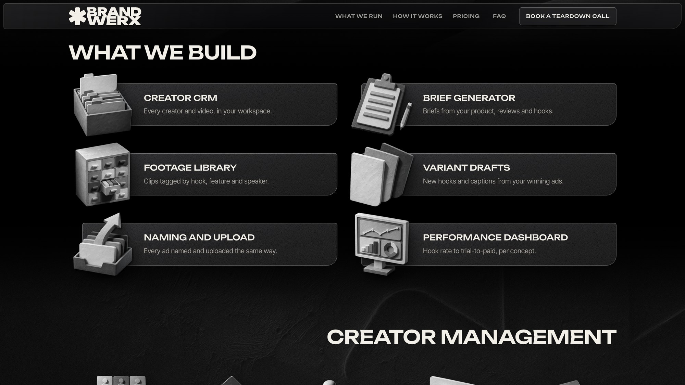
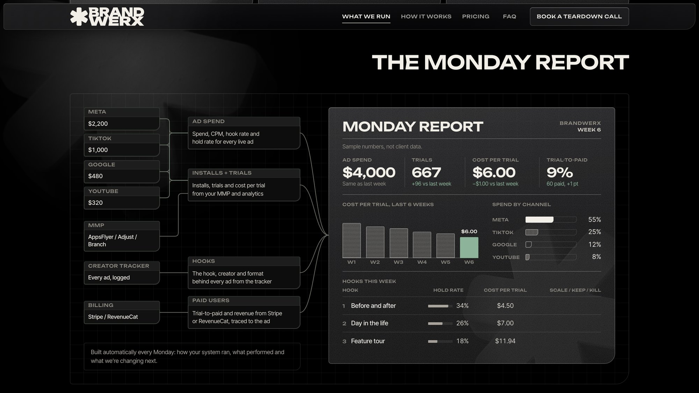

# BRANDWERX

A demo agency I built in about two days for Brez Scales and Commas's "Build Your Agency With AI" challenge. BRANDWERX makes UGC ads and builds the systems behind them for software and app companies. The website, CRM, email sequences and checkout all run on Commas.

It is a demo. The offer and prices are real choices I made, but every lead in the CRM is fictional and the numbers in the sample Monday Report are examples.

- **Live site:** https://commas.com/fnl/org_RKI26HqqTzIj/brandwerx
- **Walkthrough video (3:30, 1440p):** [video/walkthrough-1440p.mp4](video/walkthrough-1440p.mp4)

[](https://commas.com/fnl/org_RKI26HqqTzIj/brandwerx)

What's in the build:
- **Website:** one page of plain HTML, CSS and JavaScript, pasted into the Commas funnel builder's code view. No template and no framework. It opens with a blueprint intro that draws the logo and then the hero.
- **Quote builder:** three questions (ads per month, channels, ad budget) pick one of three plans, and the button goes to that plan's Commas checkout.
- **Offer:** UGC + Ads Retainer at $1,000, $1,500 or $2,500 a month, month to month. The call to action is "Book a Teardown Call".
- **CRM:** a ten-stage pipeline from New Lead to Paid Client, 25 fictional leads tagged by source, app type, budget and buying signal, 19 automations and 10 sequences.
- **Emails:** a cold sequence on days 0, 3, 7 and 12 whose first email changes with the lead's signal, plus booking, no-show, proposal, checkout and onboarding emails.





Things worth a look:
- The pipeline is the workflow. Moving a deal into a stage starts that stage's job: a research task, the cold sequence, a call confirmation, a scope task or the checkout email.
- A purchase in Commas moves the deal to Paid Client, which starts onboarding.
- Commas CRM has no custom fields, so the niche data lives in tag groups you can filter on.
- The site, the checkout and the emails use the same service names and prices, word for word.

Design:
- Black and bone, with one green accent used only for signals.
- Unbounded for display type and Inter Tight for everything else.
- Cards and buttons have small corners on three sides and a large one on the bottom right. The video frames my camera the same way.
- The logo builds itself in blueprint lines, fills, then takes itself apart. The site intro and the video both use it.

Tech stack:
- Site: HTML, CSS and JavaScript in one file, with the Web Animations API for the intro
- Hosting, CRM, email and payments: Commas
- Fonts: Unbounded and Inter Tight (Google Fonts)
- Images: WebP
- Packaging: a Python script that prepares the page for Commas
- Video: ffmpeg, with the logo animation rendered in headless Chrome

What's in this repo:

```
site/      index.html, its images and icons, screenshots, and the script that packages it for Commas
brand/     the logo, the mark and the logo animation
video/     the walkthrough
```

Run it locally:

```bash
open site/index.html
```

The booking form on the local page is a stand-in. On Commas it is swapped for the native lead form, so submissions land in the CRM.

To package the site for the Commas code view:

```bash
python3 site/build/build_commas_package.py
```

That writes `site/build/commas-html.html` and `site/build/commas.js` with every local image swapped for its hosted URL. Paste the first into the HTML box and the second into the JS box.

To play the logo animation, open `brand/logo-animation.html`.

The platform logos on the site belong to their owners and are there only to name the channels. Commas, Meta, TikTok, Google and YouTube are not affiliated with this project.
